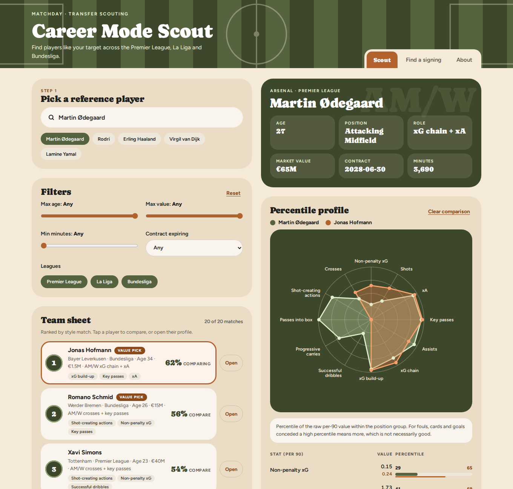
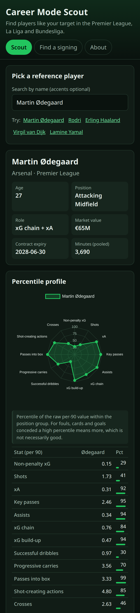

# Career Mode Scout

A FIFA career mode style scouting tool. Pick a player and get the closest matches from the Premier League, La Liga and Bundesliga, with a percentile radar and the stats behind each match. Or pick your club and a position and rank signing targets by quality, value or age.

**Live demo:** https://hasnain1241.github.io/fifa-career-mode-player-search/

| Desktop | Mobile |
|---|---|
|  |  |

The site is static (plain HTML, CSS and vanilla JS, Chart.js for the radar). All filtering and ranking runs in the browser from two JSON files.

## How the data was built
The model lives in [notebooks/scouting_model.ipynb](notebooks/scouting_model.ipynb) and is meant to run on Kaggle with Internet on. It downloads everything from the original sources, caches it, and writes `players.json` and `similar_players.json`.

1. Per-90 stats from the latest two qualifying seasons (at least 450 minutes each).
2. Players are matched across sources on normalised names, league, season and club.
3. Stats are standardised inside each position group (GK, CB, FB, DM/CM, AM/W, ST). Similarity is `1 / (1 + gap)`, where gap is the average difference in standard deviations over the stats two players share.
4. KMeans (fixed k) labels roles. Percentiles are computed within each group.

## Export schema
`export/players.json` is an array of records:
- `id`, `name`, `club`, `league`, `age`, `position_group`, `position`, `market_value_eur`, `contract_expiry`, `minutes`
- `role`, `profile_quality`, `stats_coverage`
- `stats`: per-90 values by stat key (the keys differ by position group), `pct`: percentile 0 to 100 within the group

`export/similar_players.json` maps a player id (string) to up to 20 entries `{id, score, top}`, sorted by score. `score` is 0 to 1 and only meaningful as a relative ranking. `top` holds the 3 stat keys where the pair is closest. Matches are always from the same position group.

`docs/data/` holds copies of both files for the site. Update them together with `export/`.

## Run locally
```
python3 -m http.server -d docs
```
Then open http://localhost:8000. The site uses only relative URLs, so it also works under a sub-path such as GitHub Pages.

## Limitations
- Only the Premier League, La Liga and Bundesliga are covered.
- FBref removed advanced tables for 2025/26, so tackles, clearances, blocks and aerial duels come from 2024/25 only. About 20 percent of defenders and midfielders lack them.
- Centre-back matches still lean on cards, fouls and height.
- Goalkeeper stats partly reflect the team.
- Similarity scores are modest (best matches are often 0.5 to 0.7). Read them as a ranking.
- Only the top 20 matches per player are precomputed, so strict filters can hide most of them.
- Values, ages and contracts are a snapshot from the data build.
- Not affiliated with EA, FIFA or any club.

## Next iteration
- Down-weight cards, fouls and height in the similarity and in the match explanations, then re-run the notebook and refresh the exports.
- Player pictures or mockups (needs a check on image licensing).
- Possibly move deployment from GitHub Pages to Vercel.
- More to be decided.

## Credits
- [transfermarkt-datasets](https://github.com/dcaribou/transfermarkt-datasets) (dcaribou, CC0), built from [Transfermarkt](https://www.transfermarkt.com).
- [Understat](https://understat.com) via [soccerdata](https://github.com/probberechts/soccerdata) (Apache 2.0).
- FBref tables published on Kaggle by hubertsidorowicz: [2024/25](https://www.kaggle.com/datasets/hubertsidorowicz/football-players-stats-2024-2025), [2025/26](https://www.kaggle.com/datasets/hubertsidorowicz/football-players-stats-2025-2026). FBref itself blocked direct access.
- [Chart.js](https://www.chartjs.org) (MIT).

Check each source's terms before reusing the data. Only derived per-90 values are published here.
